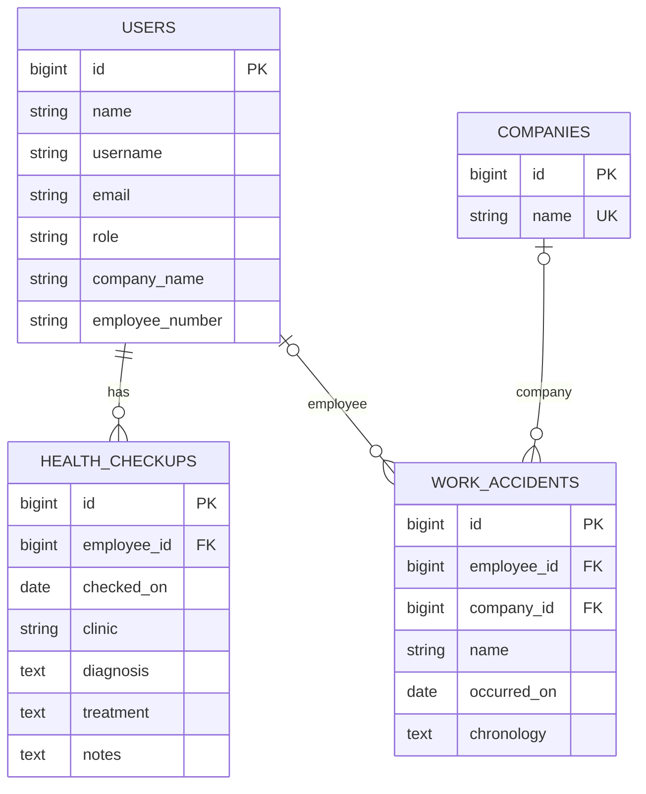

# Arsitektur Sistem

## Gambaran

Aplikasi menggunakan pola Laravel MVC. Route web menerapkan autentikasi, verifikasi email, dan middleware role. Controller memvalidasi request dan menyiapkan data, model Eloquent mewakili tabel, sedangkan Blade merender antarmuka.

## Komponen Utama

- `routes/web.php`: dashboard, rekam klinik, direktori karyawan, perusahaan.
- `routes/auth.php`: login, reset password, verifikasi email, dan logout. Registrasi mandiri tidak diaktifkan.
- `app/Http/Controllers/ClinicRecordController.php`: input kecelakaan/pemeriksaan, riwayat, dan direktori.
- `app/Http/Controllers/CompanyController.php`: daftar dan tambah perusahaan.
- `app/Http/Middleware/RoleMiddleware.php`: menolak pengguna dengan role yang tidak diizinkan.
- `app/Models`: `User`, `Company`, `HealthCheckup`, dan `WorkAccident` beserta relasinya.
- `resources/views`: halaman Blade, menggunakan layout bersama di `layouts/app.blade.php`.

## Akses Route

| Area | Role yang diizinkan | Catatan |
| --- | --- | --- |
| Dashboard | `admin`, `super_admin` | Jumlah kunjungan memakai waktu `created_at` pada hari ini; hitungan pengunjung dalam pemeriksaan mengikuti definisi dashboard saat ini. |
| Input dan riwayat pemeriksaan | `admin`, `super_admin` | Form memilih akun ber-role `employee`; ID karyawan divalidasi di server. |
| Input kecelakaan | `admin`, `super_admin` | Perusahaan wajib dipilih dari tabel `companies`. |
| Direktori karyawan | `admin`, `super_admin` | Query dibatasi ke role `employee`; detail role lain mengembalikan 404. |
| Pengelolaan perusahaan | `super_admin` | Middleware berlaku pada GET dan POST. |
| Autentikasi | Tamu/pengguna login sesuai route | Tidak ada route registrasi publik. |

## Relasi Data

`users.company_name` adalah teks biasa dan tidak memiliki foreign key ke `companies`. `work_accidents.employee_id` dan `company_id` nullable; ketika akun/perusahaan dihapus, FK terkait diatur menjadi null. `health_checkups.employee_id` wajib dan mengikuti aturan cascade pada migrasi.

## Migrations

Migration files berada di `database/migrations` dan mencakup tabel akun, cache, queue, pemeriksaan kesehatan, kecelakaan, perusahaan, serta perubahan role/detail pengguna. Jalankan `php artisan migrate:status` untuk melihat status pada database yang dikonfigurasi oleh `.env`, lalu `php artisan migrate` untuk menerapkan migrasi pending.

Jangan mengubah migration yang sudah diterapkan di database bersama/produksi. Buat migration baru untuk perubahan berikutnya. Hindari `migrate:fresh` pada database yang memiliki data.

## Alur Pemeriksaan

1. Controller mengambil akun role `employee` dan menghitung jumlah riwayat masing-masing.
2. Form menyarankan nama dan `company_name`, serta menandai akun tanpa riwayat.
3. Admin memilih hasil saran; form mengirim `employee_id`, bukan nama bebas.
4. Server memvalidasi bahwa ID merujuk akun role `employee` dan memvalidasi field rekam klinik.
5. Rekam baru disimpan ke `health_checkups` dan terhubung ke akun tersebut.

Karyawan tanpa riwayat berarti akun karyawan sudah ada tetapi belum memiliki baris pemeriksaan. Aplikasi belum menyediakan halaman pendaftaran akun karyawan.

## Batasan dan Risiko yang Diketahui

- Tidak ada kolom status kunjungan/pemeriksaan. Hitungan "menunggu pemeriksaan" pada dashboard belum merupakan workflow status tersendiri.
- Perusahaan pada profil karyawan masih ditulis sebagai `users.company_name`, terpisah dari tabel `companies`.
- Registrasi mandiri dinonaktifkan karena role default database adalah `admin`. Jika registrasi dibutuhkan lagi, tetapkan role aman secara eksplisit dan jangan menerima role dari input pengguna.
- Seeder memakai password pengembangan yang diketahui. Jangan gunakan akun seeder di lingkungan produksi.
- Rekam kesehatan memerlukan kontrol akses, HTTPS, backup terenkripsi/terlindungi, dan kebijakan retensi yang sesuai.
